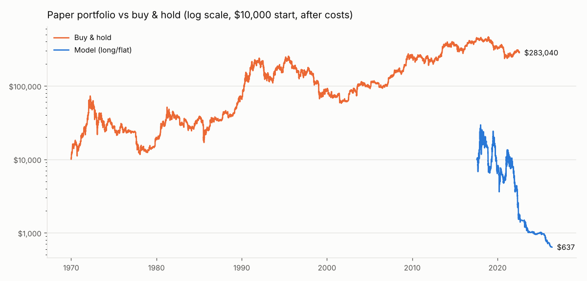
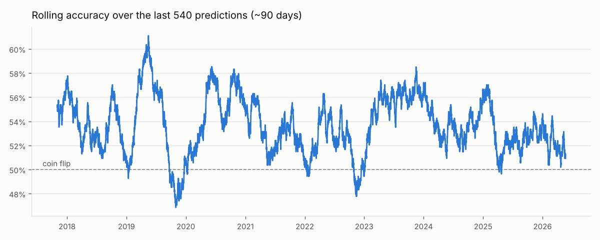

# Walk-forward backtest: BTC-USD, next 4h candle

Generated by `python scripts/backtest.py`. Every number below except the
holdout section comes from the walk-forward period only. **The holdout (2026-05-23 → 2026-11-23)
was evaluated once, on 2026-11-23, after the design above was frozen.**

- Period traded: 2017-08-03T08:00:00+00:00 → 2026-05-23T00:00:00+00:00
- Predictions: 19,198 (one per closed 4h candle, 115 windows of 168 bars)
- Costs: 0.10% fee + 0.05% slippage per side; long/flat, $10,000 start
- Runtime: 8.8 min

## Results

| Strategy | Accuracy | AUC | Log loss | Brier | Return % | Max DD % | Sharpe | Exposure % | Trades |
| --- | ---: | ---: | ---: | ---: | ---: | ---: | ---: | ---: | ---: |
| Model | 53.66% | 0.554 | 0.6890 | 0.2479 | -93.6 | -97.8 | -0.30 | 47.5 | 2,181 |
| Model, m = 0 (no threshold) | – | – | – | – | -99.1 | -99.8 | -0.60 | 71.2 | 3,429 |
| Buy & hold | – | – | – | – | 2,730.4 | -84.0 | 0.90 | 100.0 | 1 |
| Always up | 51.27% | 0.500 | – | – | 2,730.4 | -84.0 | 0.90 | 100.0 | 1 |
| Momentum | 45.94% | 0.452 | – | – | -100.0 | -100.0 | -3.47 | 51.3 | 5,189 |
| Random | 49.36% | 0.493 | – | – | -100.0 | -100.0 | -2.74 | 50.2 | 4,872 |

Accuracy / AUC / log loss / Brier use `p > 0.5` as the prediction. Trading uses the
decision rule `long if p > 0.5 + m`. "Trades" counts entries (flat → long); every
entry and exit pays the per-side cost. "Always up" trades exactly like buy & hold;
"Model, m = 0" shows what the threshold changed. Sharpe is annualised from 4h
returns (2,190 bars a year, risk-free rate 0).

- Accuracy is 53.66% on 19,198 predictions; the binomial test against a coin flip gives p = 3.5e-24 (different from 50% at the 5% level).
- 51.27% of bars closed up, so 'always up' scores 51.27%. One-sided test that the model beats that rate: p = 1.75e-11.
- AUC 0.554 (0.5 = no ranking skill).
- After costs the model returned -93.6% vs 2,730.4% for buy & hold (lower), Sharpe -0.30 vs 0.90 (lower), max drawdown -97.8% vs -84.0%, in the market 47.5% of the time.

### By year

| Year | Predictions | Accuracy | Model return % | Buy & hold return % | Exposure % |
| --- | ---: | ---: | ---: | ---: | ---: |
| 2017 | 905 | 56.24% | 152.2 | 394.8 | 71.3 |
| 2018 | 2,144 | 52.99% | -70.8 | -72.5 | 87.7 |
| 2019 | 2,190 | 53.33% | -5.3 | 95.2 | 81.9 |
| 2020 | 2,196 | 55.46% | 6.0 | 307.3 | 65.3 |
| 2021 | 2,190 | 52.47% | -36.0 | 59.2 | 63.4 |
| 2022 | 2,190 | 52.24% | -69.2 | -64.7 | 41.6 |
| 2023 | 2,190 | 56.12% | -30.2 | 155.8 | 30.9 |
| 2024 | 2,196 | 54.01% | -2.1 | 120.9 | 3.2 |
| 2025 | 2,146 | 52.42% | -26.9 | -5.3 | 13.9 |
| 2026 | 851 | 51.47% | -12.6 | -14.1 | 2.1 |

## Holdout (evaluated once, 2026-11-23)

The last six months were set aside before any development run and opened exactly
once, after the walk-forward results above were reviewed and the design was frozen.
Nothing was changed after seeing these numbers. The holdout runs the same pipeline as
the walk-forward: windows of 168 bars, the first trained on every development row,
feature selection + tuning in its first window and every 6th after that,
threshold m chosen in every window on out-of-fold training predictions.

- Period: 2026-05-23T00:00:00+00:00 → 2026-11-23T00:00:00+00:00 (1,104 predictions, 7 windows)

| Strategy | Accuracy | AUC | Log loss | Brier | Return % | Max DD % | Sharpe | Exposure % | Trades |
| --- | ---: | ---: | ---: | ---: | ---: | ---: | ---: | ---: | ---: |
| Model | 53.08% | 0.547 | 0.6911 | 0.2490 | -6.3 | -7.2 | -1.43 | 3.3 | 35 |
| Model, m = 0 (no threshold) | – | – | – | – | -54.3 | -58.1 | -4.79 | 62.1 | 231 |
| Buy & hold | – | – | – | – | -19.1 | -34.7 | -0.85 | 100.0 | 1 |
| Always up | 49.46% | 0.500 | – | – | -19.1 | -34.7 | -0.85 | 100.0 | 1 |
| Momentum | 45.38% | 0.456 | – | – | -69.1 | -70.3 | -8.15 | 49.4 | 301 |
| Random | 52.81% | 0.526 | – | – | -60.7 | -61.9 | -6.77 | 49.9 | 279 |

- Accuracy 53.08% on 1,104 predictions; binomial test vs a coin flip
  p = 0.0437 (different from 50% at the 5% level).
  49.46% of holdout bars closed up; one-sided test that the model beats
  that rate: p = 0.0087.
- After costs the model returned -6.3% vs -19.1% for buy & hold
  (max drawdown -7.2% vs -34.7%), in the market
  3.3% of the time.
- Selection rounds: window 0 (training through 2026-05-22): SFS@5 `ret_lag_1`, `ret_lag_2`, `vol_6`, `hour`, `range_close`; window 6 (training through 2026-11-06): RFE@8 `ret_lag_1`, `ret_lag_6`, `hour`, `day_of_week`, `ret_lag_2`, `volume_z`, `vol_6`, `range_close`. Thresholds m per window: 0.100, 0.100, 0.100, 0.100, 0.100, 0.100, 0.100.

## Feature-selection stability

Selection ran 20 times (every 6th window, on that window's
training rows only). The chosen ranker was SFS 19×, RFE 1×;
chosen K was 3: 2×, 5: 4×, 8: 14×.

| Feature | Selected (of 20) | Share | Ranked first | In MRMR top-K | In RFE top-K | In SFS top-K |
| --- | ---: | ---: | ---: | ---: | ---: | ---: |
| `ret_lag_1` | 20.0 | 100% | 13.0 | 20.0 | 20.0 | 20.0 |
| `ret_lag_2` | 18.0 | 90% | 0.0 | 11.0 | 14.0 | 18.0 |
| `hour` | 15.0 | 75% | 2.0 | 17.0 | 14.0 | 15.0 |
| `ret_lag_6` | 15.0 | 75% | 0.0 | 19.0 | 18.0 | 15.0 |
| `volume_z` | 15.0 | 75% | 0.0 | 0.0 | 12.0 | 15.0 |
| `day_of_week` | 11.0 | 55% | 5.0 | 17.0 | 6.0 | 12.0 |
| `vol_6` | 10.0 | 50% | 0.0 | 0.0 | 10.0 | 10.0 |
| `rsi_14` | 10.0 | 50% | 0.0 | 4.0 | 10.0 | 10.0 |
| `range_close` | 8.0 | 40% | 0.0 | 0.0 | 8.0 | 7.0 |
| `vol_42` | 7.0 | 35% | 0.0 | 18.0 | 1.0 | 7.0 |
| `ret_lag_12` | 6.0 | 30% | 0.0 | 8.0 | 9.0 | 6.0 |
| `ema_diff` | 2.0 | 10% | 0.0 | 0.0 | 9.0 | 2.0 |
| `ret_lag_3` | 1.0 | 5% | 0.0 | 15.0 | 2.0 | 1.0 |
| `ret_lag_42` | 0.0 | 0% | 0.0 | 9.0 | 5.0 | 0.0 |

"In X top-K" counts the rounds in which the feature was inside that ranker's first K,
for the K chosen in that round, whether or not that ranker won.

### Selection rounds

| Window | Training rows | Training through | Method@K | Selected features (in order) | m |
| ---: | ---: | --- | --- | --- | ---: |
| 0 | 4,380 | 2017-08-03 | SFS@3 | `hour`, `ret_lag_1`, `ret_lag_12` | 0.100 |
| 6 | 5,388 | 2018-01-18 | SFS@5 | `hour`, `volume_z`, `ret_lag_1`, `ret_lag_6`, `ret_lag_2` | 0.000 |
| 12 | 6,396 | 2018-07-05 | SFS@8 | `day_of_week`, `volume_z`, `hour`, `vol_42`, `ret_lag_6`, `ret_lag_2`, `rsi_14`, `ret_lag_1` | 0.000 |
| 18 | 7,404 | 2018-12-27 | SFS@8 | `day_of_week`, `vol_42`, `volume_z`, `ret_lag_1`, `ret_lag_12`, `ret_lag_2`, `ret_lag_6`, `rsi_14` | 0.000 |
| 24 | 8,412 | 2019-06-13 | SFS@5 | `day_of_week`, `range_close`, `ret_lag_3`, `volume_z`, `ret_lag_1` | 0.000 |
| 30 | 9,420 | 2019-11-28 | SFS@8 | `day_of_week`, `ret_lag_1`, `ret_lag_12`, `range_close`, `ret_lag_6`, `volume_z`, `ret_lag_2`, `vol_6` | 0.000 |
| 36 | 10,428 | 2020-05-14 | SFS@8 | `day_of_week`, `ret_lag_1`, `volume_z`, `ret_lag_2`, `ret_lag_6`, `rsi_14`, `ret_lag_12`, `vol_6` | 0.000 |
| 42 | 11,436 | 2020-10-29 | SFS@8 | `ret_lag_1`, `hour`, `ret_lag_2`, `rsi_14`, `day_of_week`, `ret_lag_6`, `volume_z`, `range_close` | 0.000 |
| 48 | 12,444 | 2021-04-15 | SFS@8 | `ret_lag_1`, `ret_lag_2`, `day_of_week`, `hour`, `volume_z`, `rsi_14`, `ret_lag_6`, `vol_6` | 0.000 |
| 54 | 13,452 | 2021-09-30 | SFS@8 | `ret_lag_1`, `ret_lag_2`, `vol_6`, `hour`, `day_of_week`, `rsi_14`, `ret_lag_6`, `ret_lag_12` | 0.100 |
| 60 | 14,460 | 2022-03-17 | SFS@8 | `ret_lag_1`, `range_close`, `ret_lag_2`, `hour`, `vol_6`, `volume_z`, `ret_lag_6`, `rsi_14` | 0.000 |
| 66 | 15,468 | 2022-09-01 | SFS@3 | `ret_lag_1`, `ret_lag_2`, `ret_lag_12` | 0.100 |
| 72 | 16,476 | 2023-02-16 | SFS@8 | `ret_lag_1`, `ret_lag_2`, `volume_z`, `range_close`, `day_of_week`, `vol_42`, `hour`, `ret_lag_6` | 0.000 |
| 78 | 17,484 | 2023-08-03 | SFS@5 | `ret_lag_1`, `ret_lag_2`, `volume_z`, `vol_42`, `hour` | 0.100 |
| 84 | 18,492 | 2024-01-18 | RFE@8 | `ret_lag_1`, `ret_lag_6`, `volume_z`, `hour`, `vol_6`, `range_close`, `ret_lag_2`, `rsi_14` | 0.100 |
| 90 | 19,500 | 2024-07-04 | SFS@8 | `ret_lag_1`, `ret_lag_2`, `hour`, `volume_z`, `vol_6`, `ema_diff`, `ret_lag_6`, `range_close` | 0.100 |
| 96 | 20,508 | 2024-12-19 | SFS@8 | `ret_lag_1`, `ret_lag_6`, `ret_lag_2`, `vol_6`, `hour`, `vol_42`, `day_of_week`, `rsi_14` | 0.100 |
| 102 | 21,516 | 2025-06-05 | SFS@8 | `ret_lag_1`, `ret_lag_2`, `hour`, `volume_z`, `vol_6`, `vol_42`, `ret_lag_6`, `rsi_14` | 0.100 |
| 108 | 22,524 | 2025-11-28 | SFS@8 | `ret_lag_1`, `ret_lag_2`, `ret_lag_6`, `volume_z`, `hour`, `day_of_week`, `ema_diff`, `vol_42` | 0.100 |
| 114 | 23,532 | 2026-05-15 | SFS@5 | `ret_lag_1`, `ret_lag_2`, `hour`, `vol_6`, `range_close` | 0.100 |

Threshold m chosen per window: 0.000: 68×, 0.005: 1×, 0.010: 1×, 0.100: 45×.

## Data

- Source: Coinbase Exchange public API, 1h candles, resampled to 4h (00/04/…/20 UTC).
- 1h candles: 99,380 of 99,435 expected hours
  (55 missing: 2016: 2, 2017: 12, 2018: 22, 2019: 3, 2020: 3, 2023: 3, 2025: 5, 2026: 5).
- 4h candles: 24,859; 25 built from fewer than 4 hours,
  5 with no data at all (left empty, never filled).
- Development rows after dropping NaN: 23,578. The first 4,380 rows are only ever training data.

## Decisions

| Decision | Reason |
| --- | --- |
| Last 6 months held out before anything else runs | Model and threshold choices made by looking at a test set give optimistic scores (Known Limitation 1 of the retail project). The holdout is opened once, later, with `--evaluate-holdout`. |
| The last development row is dropped | Its label is the first holdout candle; keeping it would leak a holdout price into training. |
| Expanding walk-forward, retrain every 168 bars (4 weeks) | Every prediction is made by a model that only saw earlier candles, the way the live system will run. |
| `TimeSeriesSplit(n_splits=4, gap=1)` for tuning, 3 splits for selection | Random K-fold on time-ordered rows trains on the future (Known Limitation 2). Selection uses 3 splits to keep the SFS cost down. |
| `neg_log_loss` scoring | The model outputs a probability and the trading rule thresholds it, so calibration matters more than accuracy. |
| MRMR, RFE and forward SFS compete; (ranker, K) picked by CV log loss on the training window | Same rankers as the retail project, but the winner is chosen without the test set. |
| SFS keeps the order features were added | scikit-learn's selector returns an unordered mask, so "first K" meant column order (Known Limitation 3). |
| Selection and tuning every 6th window, reused in between | Keeps the full run at about 9 minutes on 4 CPU cores. Both still only see the training rows of the window they run in. |
| BayesSearchCV `n_iter=20`; SFS adds at most 8 features; K in {3, 5, 8} | Runtime budget. The search space is wider than the retail one (adds `colsample_bytree`, `min_child_weight`, log-uniform learning rate). |
| Threshold m chosen per window from out-of-fold training predictions | m has to cover 0.30% round-trip costs; picking it on the walk-forward results would be tuning on the test set. Grid: 0.0, 0.005, 0.01, 0.015, 0.02, 0.03, 0.04, 0.05, 0.075, 0.1. |
| NaN rows are dropped, never filled with 0 | Filling invents data (the retail pipeline filled lag NaNs with 0). |
| Empty 4h buckets stay empty; rows whose 42-bar look-back touches one are dropped | Forward-filling an outage would create flat fake candles and fake 0 returns. Partial buckets (missing hours with no trades) keep the hours that exist. |
| Only fully closed candles | A 4h candle is used only when all four hours have closed; the open candle never enters a feature. |
| Frozen `DATA_END` (2026-11-23 00:00 UTC) | The cache grows over time; freezing the cut keeps the report reproducible. |
| Fixed seed (42) for numpy, XGBoost, BayesSearchCV and the random baseline | Two runs give the same report. |

## Known Limitations

| Limitation | Why it is left |
| --- | --- |
| Selection and tuning run every 6th window, not every window | Runtime; in-between windows reuse a choice made on older (still strictly past) data. |
| One asset, one exchange, one bar size | The live system trades exactly this, so the backtest matches it. |
| Costs are a flat 0.15% per side | Real slippage depends on size and liquidity; for a $10,000 paper account it is small. |
| No short side | Long/flat only, as in the live paper portfolio. |
| The design was fixed before the run and not iterated on the results | Re-tuning features or thresholds after seeing these numbers would overfit the walk-forward period, the problem this project exists to fix. Any change would need the holdout to stay closed until it is final. |
| Bars dropped around the five data outages are skipped by every strategy alike | Buy & hold return here is computed on the same rows as the model, so it can differ slightly from the raw price change. |
